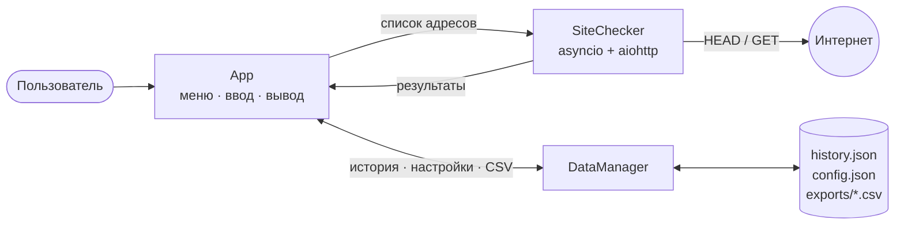
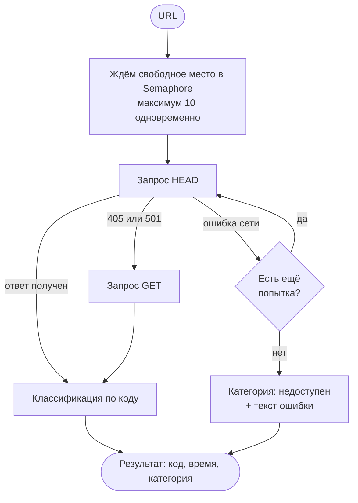

<div align="center">

# 🌐 Site Availability Checker

**Асинхронное консольное приложение для проверки доступности сайтов**

Курсовая работа по теме «Разработка приложения для проверки доступности сайтов»


</div>

---

## 📌 О проекте

Доступность веб-ресурсов напрямую влияет на работу бизнеса и качество сервиса: простой сайта — это потерянные пользователи и деньги. Проверять адреса вручную долго, особенно когда их десятки.

Приложение решает эту задачу: проверяет много сайтов **одновременно**, показывает HTTP-код, время ответа и причину сбоя, а результаты сохраняет в историю со статистикой. Благодаря `asyncio` и `aiohttp` проверка списка занимает примерно столько же времени, сколько проверка самого медленного сайта, а не сумму всех.

## ✨ Возможности

- 🔍 **Проверка одного и нескольких сайтов**, а также списка из файла `sites.txt`
- ⚡ **Метод `HEAD`** для скорости и автоматический переход на `GET` при ответе `405`
- 🚦 **Лимит нагрузки:** не более 10 одновременных запросов (`asyncio.Semaphore`)
- 🎯 **Умная классификация ответов:** доступен / ограничен (401, 403, 429) / не найден (4xx) / ошибка сервера (5xx) / недоступен
- ⏱ **Время ответа** в миллисекундах с цветовой индикацией
- 🛡 **Устойчивость к ошибкам:** таймауты, DNS, SSL, неверные URL не роняют программу; одна повторная попытка при сетевом сбое
- 🌍 **Кириллические домены** (`пример.рф`) обрабатываются через punycode
- 🕘 **История** (`history.json`) с **поиском, фильтрами и сортировкой**
- 📊 **Статистика:** общая и по каждому сайту, диаграмма доступности
- 📁 **Экспорт в CSV** (открывается в Excel с русской кодировкой)
- ⚙️ **Настройки** (таймаут, параллельность, повторы), сохраняются в `config.json`
- 🖥 **Два режима:** интерактивное меню и командная строка (для автоматизации)
- 💾 **Надёжное хранение:** атомарная запись, повреждённый файл не теряется, а переименовывается в `.bak`

## 🛠 Технологии

| Технология | Назначение |
|---|---|
| Python 3.10+ | Язык программирования |
| `asyncio` | Асинхронное выполнение, `Semaphore`, `gather` |
| `aiohttp` | Асинхронные HTTP-запросы |
| `rich` | Таблицы, цвета, прогресс-бар в консоли |
| `json`, `csv` | Хранение истории, экспорт отчётов |
| `argparse` | Режим командной строки |
| `unittest` | Автотесты (встроены в Python) |
| `os`, `time`, `datetime`, `typing`, `pathlib`, `logging` | Файлы, замеры времени, метки, аннотации типов, логи |

## 🏗 Архитектура

Три класса, у каждого одна зона ответственности:



| Класс | Отвечает за | Ничего не знает о |
|---|---|---|
| `DataManager` | файлы, история, поиск/фильтры/сортировка, статистика, CSV, настройки | сети и консоли |
| `SiteChecker` | разбор адресов, HEAD→GET, таймауты, повторы, семафор | файлах и консоли |
| `App` | меню, проверка ввода, таблицы и прогресс-бар | деталях HTTP и формате файлов |

**Как проверяется один сайт:**



## ⚙️ Установка и запуск

```bash
# 1. Клонировать репозиторий
git clone https://github.com/<ваш-логин>/site-availability-checker.git
cd site-availability-checker

# 2. (рекомендуется) виртуальное окружение
python -m venv venv
venv\Scripts\activate          # Windows
source venv/bin/activate       # Linux / macOS

# 3. Установить зависимости
pip install -r requirements.txt

# 4. Запустить
python main.py
```

> 💡 Для корректного отображения таблиц и цветов в Windows используйте **Windows Terminal** или PowerShell.

### Режим командной строки

```bash
python main.py google.com github.com          # быстрая проверка без меню
python main.py -f sites.txt                   # список из файла
python main.py -f sites.txt -t 5 --no-save    # таймаут 5 с, не сохранять в историю
python main.py --help
```

Код завершения: `0` — все сайты доступны, `1` — есть недоступные, `2` — ошибка ввода. Это удобно для скриптов и планировщика задач.

### Как классифицируются ответы

| Ответ сервера | Статус в программе | Считается доступным |
|---|---|---|
| `2xx`, `3xx` | ДОСТУПЕН | ✅ да |
| `401`, `403`, `429` | ОГРАНИЧЕН (сайт жив, не пускает бота) | ✅ да |
| `404` и другие `4xx` | НЕ НАЙДЕН | ❌ нет |
| `5xx` | ОШИБКА СЕРВЕРА | ❌ нет |
| таймаут, DNS, SSL, обрыв | НЕДОСТУПЕН | ❌ нет |

## 🧪 Тесты

```bash
python -m unittest discover -s tests -v
```

40 автотестов. Интернет не нужен: «сайты» имитирует локальный сервер `aiohttp` (коды 200/403/404/405/500, редирект, зависание для проверки таймаута). Сценарии и результаты — в [docs/TEST_CASES.md](docs/TEST_CASES.md).

## 📸 Скриншоты

### Главное меню


### Проверка списка сайтов


### История с фильтрами


### Статистика


## 📂 Структура проекта

```
site-availability-checker/
├── main.py              # весь код: DataManager, SiteChecker, App
├── sites.txt            # демонстрационный список сайтов
├── requirements.txt     # зависимости (версии закреплены)
├── tests/
│   └── test_main.py     # 40 автотестов (unittest)
├── docs/
│   ├── TEST_CASES.md    # таблица тестирования
│   └── DEFENSE.md       # подготовка к защите
├── screenshots/         # скриншоты для README
├── .gitignore
├── LICENSE
└── README.md
```

Файлы `history.json`, `config.json`, `exports/` и `site_checker.log` создаются при работе программы и в репозиторий не попадают.

## 👨‍💻 Автор

**Маматкулов Фирдавс**
Группа: АСОИ-1-25
Учебное заведение: КОМТЕХНО, Бишкек
Дисциплина: «Основы алгоритмизации и программирования», 2026

## 📄 Лицензия

MIT — см. файл [LICENSE](LICENSE).
